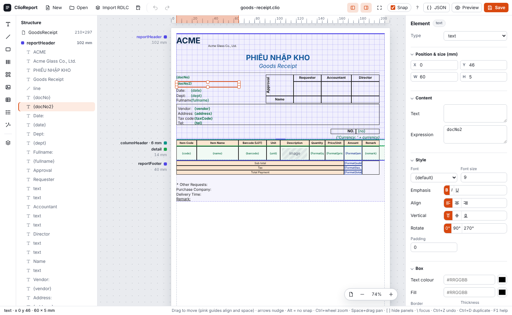

# Designer guide

The designer edits a report definition (`.clio` / JSON) visually. Start it with `dotnet run --project src/ClioReport.Designer` and open http://localhost:5178 (needed for PDF preview and RDLC import), open `wwwroot/index.html` directly to edit without preview, or use the Visual Studio extension (double-click a `.clio` file). Press `F1` or the `?` button in the designer for a short version of this page.



## Concepts

- A report is a list of **bands**: `reportHeader`, `pageHeader`, `columnHeader`, `groupHeader`, `detail`, `groupFooter`, `reportFooter`, `pageFooter`. The `detail` band repeats once per row of the **Data source**.
- A band holds **elements**: text, line, rect, barcode, QR code, image, table and list. Positions and sizes are in millimetres, relative to the band.
- Text, image, barcode and QR elements show an **expression**: a field (`Name`, `Customer.City`), arithmetic (`Qty * Price`), a function (`Format(Total, 'N0')`) or fixed text in quotes (`'Total'`). See [Expressions](#expressions) below and [README.md](README.md) for the engine rules.

## Build a report

1. Select *Report* in the Structure panel and set the page size, margin, and **Data source** (the collection that feeds the detail band).
2. Add bands with the layers button in the left rail (the menu offers each band type). Use `columnHeader` for table titles, `detail` for one row.
3. Add elements: click a tool in the rail, or drag it onto a band. Edit position, size, style and expression in the Properties panel.
4. For a grid, use the wand (**Table wizard**): pick a collection and tick its fields, then insert the table.
5. Press **Preview** to render a PDF. Without data, fields are blank.
6. **Save** (`Ctrl+S`) writes the `.clio` file; **JSON** shows or edits the raw definition.

## Expressions

An expression is evaluated for every element that shows data (text, image, barcode, QR, table columns, band `visible`, aggregates). Fixed text goes in the element's *Text* box instead, or in quotes inside an expression.

**Operands**

- Numbers: `10`, `2.5` (dot, no exponent). All numbers are `decimal`.
- Strings: `'Total'` or `"Total"`. Inside a string `\n` is a new line, `\t` a tab and `\x` the character `x`, so write file paths with `/`.
- `true`, `false`, `null`.
- Fields: `Name`, `Customer.City` (dotted paths). Names are case-sensitive; an unknown field is an error. Lookup order: variables, then the current row, then the report root.
- Variables: `PageNumber`, `PageCount`, and the names of the aggregates you declared (`tong`).

**Operators**, low to high precedence: `? :`, `||`, `&&`, `==` `!=`, `<` `<=` `>` `>=`, `+` `-`, `*` `/` `%`, unary `-` `!`, parentheses.

**Rules**

- `+` joins text when either side is text: `'No. ' + docNo`. Number arithmetic with `null` gives `null`; dividing by 0 is an error.
- Conditions (`? :`, `&&`, `||`, `!`, band `visible`) must be true/false (`null` counts as false). Write `qty > 0`, not `qty`.
- `==` also compares the type, so a number never equals a string.

**Functions** (the only ones; case-insensitive)

| Function | Result |
| --- | --- |
| `Round(x[, digits])` | Round half away from zero, 0 to 28 digits |
| `Abs(x)` | Absolute value |
| `Min(a, b)`, `Max(a, b)` | Smaller or larger of two numbers |
| `Upper(s)`, `Lower(s)`, `Trim(s)`, `Len(s)` | Text helpers |
| `IsNull(a, b)` | `a`, or `b` when `a` is null |
| `Format(x, 'fmt')` | .NET format string, invariant culture: `'N0'`, `'N2'`, `'dd/MM/yyyy'`. `null` gives empty text |

**Examples**

| Expression | Shows |
| --- | --- |
| `qty * price` | Line amount |
| `Format(qty * price, 'N0')` | Amount with thousands separators |
| `Format(date, 'dd/MM/yyyy')` | A date |
| `IsNull(note, '-')` | A dash when there is no note |
| `qty > 0 ? Format(qty, 'N0') : ''` | Blank for zero |
| `'Kho: ' + kho` | Label plus field |
| `'Trang ' + PageNumber + '/' + PageCount` | Page footer |
| `'TỔNG CỘNG: ' + Format(tong, 'N0')` | Report total from the aggregate `tong` |

Totals are not functions: declare an aggregate (see [Aggregates](#aggregates)) and use its name.

### How elements look on the canvas

- Text in braces, `{Name}`, is an **expression**; the braces are only a marker, not part of it. Text without braces (`Date:`) is fixed text from the *Text* box.
- A report imported from RDLC often shows `{(Name)}`: the importer wraps each translated piece in parentheses (`'' + (A) + (B)` when several are joined). They only group the expression, so the printed result is the same as `Name`. You can delete them, but you do not have to.
- The preview and the PDF show the evaluated values, not the braces.

## Aggregates

*Report > Aggregates > + Aggregate* declares a total you then use by name in an expression (`Format(tong, 'N0')`). Calling `Sum(qty)` directly inside an expression does not work.

| Property | Meaning |
| --- | --- |
| `name` | The variable name used in expressions |
| `function` | `sum`, `count`, `avg`, `min` or `max` |
| `expression` | What to add up, e.g. `qty * price` |
| `group` | Group name to reset on; empty = the whole report |

- `count` counts non-null values; the others need numbers and skip nulls.
- The value is the running total up to the band being printed: the third detail row sees the first three rows. Put the total in a `reportFooter` or `groupFooter` to show the final figure. Page header/footer bands only see report-wide totals.
- Not available: `First`, `Last`, `CountDistinct`, `StDev`, `Var`, and `Sum(...)` over a child collection (add it up in the data you pass in). The RDLC importer turns `Sum(Fields!X.Value)` into an aggregate and reports the unsupported functions.

## Groups

*Report > Groups* lists the groups; each has a `name`, an `expression` (a new group starts when its value changes) and `pageBreakBefore`.

- **Several levels**: add several groups. Their order is the nesting, outermost first (`kho`, then `loai`). When a value changes, the inner groups close first (footers from the inside out) and then the new headers open.
- Each group has its own `groupHeader` and `groupFooter` bands; pick the group in the band's *Group* box.
- **Several fields in one level**: a group has one expression, so join the fields: `kho + '|' + loai`. Use a separator, and `Format(...)` on numbers, so `'1' + '23'` is not confused with `'12' + '3'`.
- The rows must already be sorted in the same order as the groups (outermost first); the engine does not sort.

## Data you pass in

The engine reads one `IDataContext`; `ObjectDataContext` builds it from plain objects:

```csharp
var data = new ObjectDataContext(
    root: header,                                                          // object with the header/footer fields
    sources: new Dictionary<string, object> { ["items"] = rows });         // named row collections
```

- **Root** is one object (class, anonymous type, dictionary, `DataRow`); its properties are the fields outside the rows (`DocNo`, `Customer.City`). It may be null.
- **Rows**: the collection the `detail` band repeats, found by the report's **Data source** (case-insensitive). It can be a `List<T>`, `DataTable`, `DataView` or any `IEnumerable`, in `sources` or as a property of the root. A table's or list's own *source* can name another collection, or a child collection inside the current row.
- A report ported from RDLC with `First(Fields!X.Value)` can use the first row as root and all rows as the collection:

```csharp
var rows = data;                                   // flat list of rows
var ctx = new ObjectDataContext(rows.FirstOrDefault(),
    new Dictionary<string, object> { ["PurchaseRequest"] = rows });   // name = the report's Data source
```

  Inside a detail band, a field is looked up in the current row first, then in the root. `data[0]` throws on an empty list, so use `FirstOrDefault()`.
- The sample JSON of the designer has the same shape: values for the root and arrays for the collections.

## Data fields

Define the fields once and they are kept in the report. In *Report > Data fields* (or at the bottom of an element's *Data fields* section) choose **Define from JSON…**, paste an example of the data (an object with values and lists of rows, or just a list of rows) or pick a file, and press **Use**. The names and types (text, number, date) are stored in the `.clio` file under `schema`; loading a sample while the report has none saves them automatically. After that the fields are listed, and offered by the Table wizard, without loading any file. A sample that is loaded takes precedence while it is there; **Update from sample** replaces the saved fields with it and **Clear** removes them. The engine ignores `schema`.

## Sample data

With a text, barcode or QR element selected, the **Data fields** section of the Properties panel lists what the sample offers: the fields of the data source's rows, the report-level fields, and the variables (`PageNumber`, `PageCount`, your aggregates). Click one to insert it into the Expression box at the caret (a box holding only a field name is replaced). *Load sample data…* there loads the file without opening the preview.

*Preview > Sample data…* loads a JSON file: an object whose properties are values (`"Customer": "ACME"`) and arrays of rows (`"items": [ { "Name": "...", "Qty": 2 } ]`). It is used for the preview and to list the fields in the Table wizard. It is remembered in the browser and is never written into the report.

## Table total row

In a table that reads a collection (*source*), set **Total** on a column (`sum`, `count`, `avg`, `min`, `max`) to end the table with a total row. The value is computed over the column's expression for every row (nulls skipped). **Total format** takes a .NET format such as `N0` or `N2`; **Total label** (Table style) is the text in the first column that has no total, e.g. `Total`. The row is bold and filled like the header. Fixed-row tables cannot have totals.

## Fonts

Text and table elements have a **Font** dropdown. The list is the families the host registered (`PdfRenderOptions.Fonts`; the bundled `ClioReport.Pdf.Fonts` package registers Arial, Times New Roman and Courier New, with Hangul fallback). Leave it empty to use the report default. See the README for registering fonts on Linux or Docker.

## Images

An image element's expression gives either a `byte[]` (PNG, JPEG, BMP) or a file path. Paths are resolved inside the **Image folder** (Preview toolbar; the designer guesses it from the report's folder) and cannot leave it. Use forward slashes (`logo/company.png`); backslashes are escapes inside expression strings. A missing file prints a dashed "No image" box instead of failing.

## Shortcuts

| Keys | Action |
| --- | --- |
| `Ctrl` + wheel / pinch | Zoom around the pointer |
| `Space` + drag, middle button drag | Pan |
| `Ctrl+0`, `Ctrl` + `+` / `-` | Fit width, zoom in steps |
| Drag, arrow keys (`Shift` = 5 mm) | Move elements; pink guides snap to neighbours, band edges and equal gaps; `Alt` skips snapping |
| `Shift` / `Ctrl` + click, `Ctrl+A` | Select several elements |
| `Ctrl+D`, `Delete` | Duplicate, delete |
| `Ctrl+Z`, `Ctrl+Y` | Undo, redo |
| `Ctrl+S` | Save |
| `[`, `]`, `\`, `Esc` | Hide Structure, hide Properties, focus mode (canvas only), leave focus mode / select parent |
| `F1` | Help |

The panels can be resized by dragging their edge (double-click resets), and the button next to the zoom shows only the area with bands instead of the whole page. The layout is remembered per browser.

## Import

*Import RDLC* converts a `.rdlc` / `.rdl` report (common subset); anything it could not map is listed as a warning.
